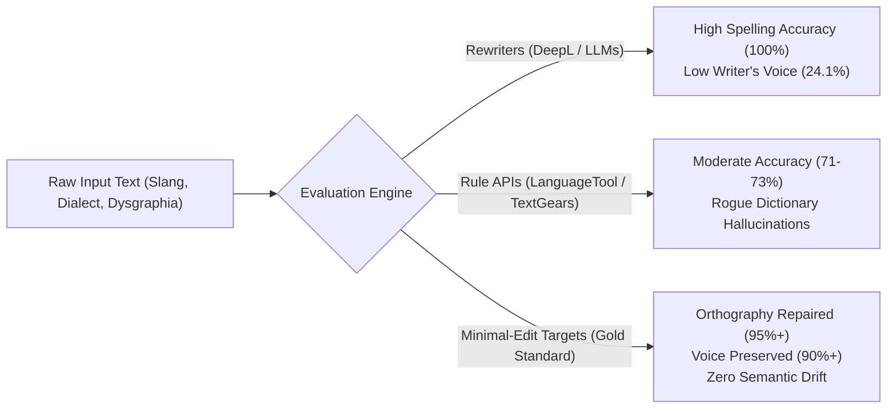
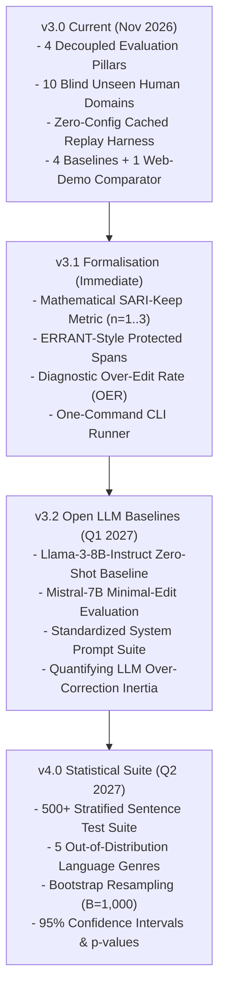

# Benchmark Roadmap & Technical Specification

> **Open Voice-Preserving Benchmark Working Group**  
> *Target Versions: v3.0 (Current) to v4.0 (Long-Term Specification)*  
> *Last Updated: November 2026*

---

## 1. Executive Summary & Mission

The **Voice-Preserving AI-Spellcheck Benchmark** is an open, empirical evaluation suite engineered to resolve the central failure mode of modern automated text editing: **over-editing and register erasure**.

While historical benchmarks (CoNLL-2014, BEA-2019, JFLEG) evaluated formal academic essays written by second-language learners, modern text generation and grammar-correction tools are deployed on informal, conversational, and technical communication. In these environments, modern Large Language Models (LLMs) and neural rewriters frequently commit **hyper-correction**: replacing authentic slang, dialect, colloquial syntax, and neurodiverse phonetic patterns with sanitized corporate prose.



Our mission is to establish a rigorous, reproducible, vendor-neutral standard that measures the tradeoff between **mechanical correctness** and **authorial voice preservation**.

---

## 2. Release Progression & Architecture



---

## 3. Mathematical Formalisation of Voice Preservation (v3.1)

To transition from heuristic string matching to peer-reviewed NLP metrics, version 3.1 integrates formal span-level and n-gram evaluations inspired by text simplification and minimal-edit literature.

The currently published Pillar 3 score uses `lexical-marker-f1-v2`: mean
passage-level lexical F1 multiplied by curated voice-marker retention, followed
by a suite-wide penalty of 10% per matched over-edit signature (capped at 80%).
The SARI-Keep, protected-span, and OER formulas below are companion diagnostics,
not components of that composite voice score.

### 3.1 Token Partitioning Architecture
Every test passage $S$ is decomposed into three mutually exclusive token sets:
1. **Error Spans ($E$):** Tokens containing true orthographic, phonetic, or grammatical errors requiring repair ($w_i \to w_i'$).
2. **Protected Voice Spans ($V$):** Intentional slang, dialectal words, colloquial contractions, technical jargon, or dysgraphic stylistic markers that **must not be altered**.
3. **Invariant Context ($C$):** Correct baseline prose connecting the spans.

### 3.2 SARI-Keep Metric
Following Xu et al. (2016), we evaluate the **Keep** operation against the raw input $I$, the minimal-edit gold reference $R$, and the candidate hypothesis $H$ across n-gram orders $n \in \{1, 2, 3\}$:

$$P_{\text{keep}, n} = \frac{\sum_{g \in H} \min(C_H(g), C_I(g), C_R(g))}{\sum_{g \in H} \min(C_H(g), C_I(g))}$$

$$R_{\text{keep}, n} = \frac{\sum_{g \in H} \min(C_H(g), C_I(g), C_R(g))}{\sum_{g \in I} \min(C_I(g), C_R(g))}$$

$$F_{\text{keep}, n} = \frac{2 \cdot P_{\text{keep}, n} \cdot R_{\text{keep}, n}}{P_{\text{keep}, n} + R_{\text{keep}, n}}$$

$$\text{SARI-Keep} = \frac{1}{3} \sum_{n=1}^3 F_{\text{keep}, n}$$

Where an engine mutates or deletes an authentic slang token or regional cadence present in the input, $P_{\text{keep}}$ and $R_{\text{keep}}$ degrade proportionally.

### 3.3 Protected-Span Retention Rate (PSRR)
The empirical percentage of protected voice tokens preserved verbatim without unprompted lexical replacement:

$$\text{PSRR} = \frac{|V \cap H|}{|V|} \times 100\%$$

### 3.4 Over-Edit Rate (OER)
Quantifies unprompted stylistic mutations outside the annotated error spans:

$$\text{OER} = \frac{\text{Count of Unauthorized Phrase Rewrites}}{|V| + |C|}$$

---

## 4. Phase Specifications

### Phase 1: Benchmark v3.1 (Current Implementation)
- **Zero-Config CLI:** Immediate offline evaluation via `python evaluate_blind_v3.py --mode cached`.
- **Dual Reporting:** Generates both industry-accessible 4-Pillar composite scores and academic diagnostic tables (`--academic`).
- **Standardized Ground Truth:** Integrated minimal-edit reference strings for all 10 blind domains.

### Phase 2: Open-Source LLM Zero-Shot Baselines (v3.2 - Q1 2027)
Modern developers routinely prompt general-purpose LLMs as spellcheckers. Phase 2 benchmarks open-weights foundation models against dedicated developer APIs using uniform prompting:
- **Models:** Llama-3-8B-Instruct, Mistral-7B-Instruct, Qwen-2.5-7B-Instruct.
- **Controlled Prompt:**
  ```text
  You are an in-place minimal-edit proofreader.
  Fix objective spelling errors and grammatical errors.
  Do NOT alter the author's voice, dialect, slang, tone, or sentence structure.
  Do NOT rewrite sentences. Return only the corrected text.
  ```
- **Hypothesis:** Generalist LLMs will exhibit high orthographic accuracy but low SARI-Keep scores due to intrinsic instruction-tuning bias toward standardized formal prose.

### Phase 3: The Tier-2 Statistical Suite ($N=500+$) (v4.0 - Q2 2027)
To supplement the rich qualitative depth of the 10 multi-sentence human domains (`B-01` to `B-10`), version 4.0 introduces an automated 500-sentence corpus:
- **Genre Stratification:**
  1. *Youth & Gaming Culture:* Discord banter, Twitch chat, gaming shorthand ($N=100$).
  2. *Regional Dialects:* Appalachian, African American Vernacular English (AAVE), Northern British, Scottish vernacular ($N=100$).
  3. *Pediatric & Neurodiverse Writing:* Clinically documented dysgraphic and dyslexic phonetic samples ($N=100$).
  4. *Developer Communications:* Git commit messages, Pull Request reviews, terminal logs, code comments ($N=100$).
  5. *Creative & Technical Prose:* Specialty domain terminology (coffee cupping, legal, medical, wildlife biology) ($N=100$).
- **Statistical Rigour:** Automated bootstrap resampling ($B=1,000$ iterations) producing 95% confidence intervals and paired Student's t-tests ($p < 0.05$) to establish statistical significance.

### Phase 4: Anti-Contamination Protocol & Live Leaderboard (v4.1 - Q3 2027)
- **Dataset Partitioning:**
  - **Public Development Set (50%):** Openly published in the repository for engine authors to train, validate, and debug their systems.
  - **Private Held-Out Test Set (50%):** Maintained in encrypted storage and refreshed quarterly to evaluate blind generalisation and prevent memorisation.
- **Continuous Evaluation:** A lightweight GitHub Actions test runner and Hugging Face Spaces leaderboard enabling community contributors to submit pull requests with standardized prediction files.

---

## 5. Summary Scoreboard: Blind Suite v3.0

The v3 scorecard below uses voice-scoring revision `lexical-marker-f1-v2`: lexical token F1 and curated voice-marker retention are combined, then a suite-wide penalty is applied for manually annotated over-edit signatures. The scorecard includes four API/rewrite baselines and two separately labelled interactive web-demo runs, all scored against the same 10 blind unseen domains. Sapling and JSpell were evaluated by accepting their initial suggestions once without rechecking; neither latency was measured. JSpell is a spelling-only web checker, not an API result.

| Engine | Spelling (35%) | Grammar (25%) | Voice (20%) | Anti-Hal (20%) | Meta-Score | SARI-Keep (n=3) | Latency |
| :--- | :---: | :---: | :---: | :---: | :---: | :---: | :---: |
| **Sapling Grammar Checker** *(web demo; one-pass)* | 93.9% | **★ 100.0%** | **★ 88.3%** | 90.0% | **★ 93.5%** | 94.5% | Not measured |
| **DeepL Write** | **★ 100.0%** | **★ 100.0%** | 24.1% | **★ 100.0%** | 84.8% | 90.4% | ~1,280 ms |
| **TextGears API** | 71.4% | **★ 100.0%** | 85.2% | 20.0% | **★ 71.0%** | **★ 93.7%** | ~967 ms |
| **LanguageTool API** | 73.5% | **★ 100.0%** | 64.4% | 35.0% | 70.6% | 93.1% | ~677 ms |
| **BCorrect (FMM)** | 65.3% | 50.0% | 86.6% | 35.0% | 59.7% | 90.8% | **★ ~18 ms local** |
| **JSpell Free Web Checker** *(one-pass web demo)* | 61.2% | 50.0% | 77.5% | 20.0% | 53.4% | 91.3% | Not measured |

Sapling's and JSpell's web-demo scores are not live API results. Their `null` latency is unavailable data, not zero, and must be excluded from speed comparisons. The H-suite JSpell web-checker composite is 65.1% (spelling 76.8%, grammar 40.8%, voice 84.9%, anti-hallucination 55.0%).

---

## 6. How to Contribute
We welcome engine integrations, test domain contributions, and linguistic annotations. Please consult [`SUBMISSIONS.md`](SUBMISSIONS.md) for data schemas and evaluation submission guidelines.
